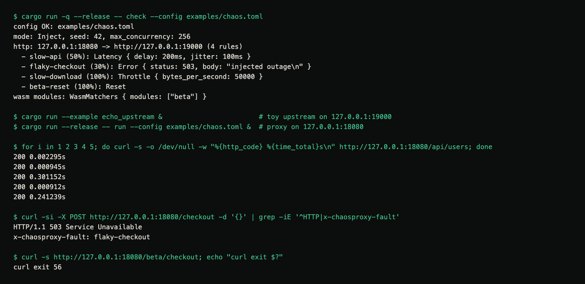
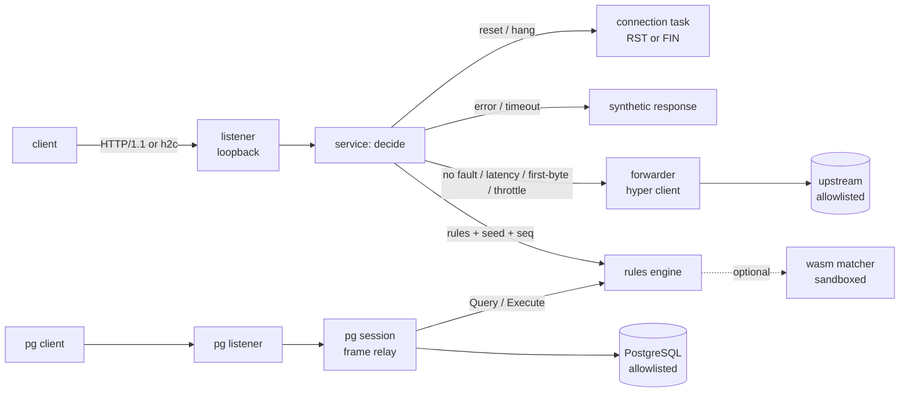

# ChaosProxy-L7


**A loopback-by-default fault-injection proxy that makes your HTTP services and PostgreSQL database misbehave on purpose, reproducibly, so you can test how your application copes.**

> **Status: experimental, 0.1.0, not production-ready.** It is a testing tool. **Never put it in front of production traffic.** No TLS on either side.

[Case study ↗](https://hellpuff.dev/work/chaosproxy-l7)

## Demo



Real terminal capture (macOS, Apple M5, release build, `examples/chaos.toml` with `seed = 42`). The same commands
as text:

```console
$ cargo run --example echo_upstream &                        # toy upstream on 127.0.0.1:19000
$ cargo run --release -- run --config examples/chaos.toml &  # proxy on 127.0.0.1:18080
$ for i in 1 2 3 4 5; do curl -s -o /dev/null -w "%{http_code} %{time_total}s\n" http://127.0.0.1:18080/api/users; done
200 0.002295s
200 0.000945s
200 0.301152s
200 0.000912s
200 0.241239s
$ curl -si -X POST http://127.0.0.1:18080/checkout -d '{}' | grep -iE '^HTTP|x-chaosproxy-fault'
HTTP/1.1 503 Service Unavailable
x-chaosproxy-fault: flaky-checkout
$ curl -s http://127.0.0.1:18080/beta/checkout; echo "curl exit $?"
curl exit 56
```

The third and fifth requests hit the `slow-api` latency rule, the checkout request hits `flaky-checkout`, and the
`/beta/` request is reset by a rule whose WebAssembly matcher selected it (curl exit 56 is "connection reset").
Run it again with the same `seed` and the same request order and the same requests are delayed by about the same
amounts and the same checkout request fails: the audit run that made this capture and two earlier runs produced
the identical pattern.

## Why

Timeouts, slow first bytes, dropped connections and serialization failures cause real outages, but they are
hard to trigger on demand. ChaosProxy-L7 sits between your code and a dependency **on your machine or in CI**
and injects those failures at the protocol layer, scoped by rule, with a seeded random generator.

**Who it is for:** developers and SREs writing resilience tests (retries, timeouts, circuit breakers, transaction
retry loops) and anyone who wants a reproducible "the database just dropped my connection" in a test.

**Compared with alternatives:** [Toxiproxy](https://github.com/Shopify/toxiproxy) works at the TCP level and is a
mature, excellent choice for byte-level faults; it cannot answer an HTTP request with a 503 or fail one specific
SQL statement with SQLSTATE `40001`. Service-mesh fault injection (Envoy/Istio) needs a mesh. ChaosProxy-L7 is a
single local binary that understands HTTP and the PostgreSQL wire protocol, so faults can target a route, a
header, or a query, and it refuses to listen beyond loopback unless you opt in twice.

## Quick start

Requires Rust **1.97+** (wasmtime's minimum). No other services needed.

```sh
git clone https://github.com/hellpuffyt/ChaosProxy-L7 && cd ChaosProxy-L7
cargo test --all-features                                  # unit + integration tests
cargo run --release -- check --config examples/chaos.toml  # validate the demo config
cargo run --example echo_upstream &                        # demo upstream on 127.0.0.1:19000
cargo run --release -- run --config examples/chaos.toml --pretty
```

Then in another terminal: `curl -i http://127.0.0.1:18080/api/users`. Stop with Ctrl-C (graceful shutdown).

`chaosproxy check` prints what a config will do:

```console
$ chaosproxy check --config examples/chaos.toml
config OK: examples/chaos.toml
mode: Inject, seed: 42, max_concurrency: 256
http: 127.0.0.1:18080 -> http://127.0.0.1:19000 (4 rules)
  - slow-api (50%): Latency { delay: 200ms, jitter: 100ms }
  - flaky-checkout (30%): Error { status: 503, body: "injected outage\n" }
  - slow-download (100%): Throttle { bytes_per_second: 50000 }
  - beta-reset (100%): Reset
wasm modules: WasmMatchers { modules: ["beta"] }
```

## Features

### Implemented (tested)

| Area | What |
|---|---|
| HTTP forwarding | HTTP/1.1 and h2c (HTTP/2 prior knowledge) on one listener; HTTP/1.1 or h2c to the upstream; hop-by-hop header stripping (incl. headers named in `Connection`); `X-Forwarded-For/Proto/Host`; `x-request-id`; streaming bodies with backpressure; upstream response timeout (504); unreachable upstream (502); client disconnect cancels the upstream request (also mid-body); slow-header protection; graceful shutdown (in-flight requests get `shutdown_grace`, then are aborted with their upstream requests) |
| HTTP faults | `latency` (+ uniform jitter), `first_byte_delay`, `throttle` (bytes/s), `reset` (TCP RST via `SO_LINGER=0`), `timeout` (504 after N), `hang` (no answer, close after N), `error` (status + body, upstream not contacted) |
| Matching | path prefix, path regex, methods, exact header values, optional WebAssembly module; first matching rule wins; percentage roll from `seed` + request sequence number; `max_concurrent` cap per rule |
| PostgreSQL | v3 wire-protocol proxy: startup, `SSLRequest`/`GSSENCRequest` declined with `N`, `CancelRequest` relayed, auth passthrough (SCRAM tested), simple and extended query protocol; faults `error` (SQLSTATE), `delay`, `drop_mid_result` (after N rows), `reject_startup`; correct response ordering with pipelined batches |
| WebAssembly | matcher ABI v1 on Wasmtime: no imports (no WASI), fuel limit, wall-clock limit (epoch interruption), memory limit, fresh instance per decision; load errors refuse startup, runtime errors fail closed |
| Safety | loopback-only unless `allow_non_loopback = true` **and** `--allow-non-loopback`; every upstream must be in `upstream_allowlist`; `mode = "observe"` / `--dry-run`; global `max_concurrency` (excess shed with 503 / SQLSTATE 53300); strict config validation with actionable errors |
| Logs | JSON lines with request ids and rule ids; exactly one access-log line per request, including requests that never get a response (`reset`/`hang` faults, client disconnects, shutdown: `aborted=true`); never logs bodies, header values, query strings, passwords, or SQL text (unless `log_query_text = true`) |

### Experimental

- Windows: CI runs the portable test suite on `windows-latest`, but nobody has run the proxy on Windows by hand.
- h2c: no TLS/ALPN, so browsers cannot use HTTP/2 through it; `curl --http2-prior-knowledge` and gRPC-style clients can.

### Planned (not implemented)

TLS termination and TLS to upstreams · WebSocket / `Upgrade` passthrough (currently answered with 501) ·
response-body corruption faults · multiple upstreams / routes per listener · PostgreSQL faults on `COPY` ·
WebAssembly modules that choose the fault, not just whether a rule applies. See [docs/LIMITATIONS.md](docs/LIMITATIONS.md).

## Architecture



The forwarding path (`src/http/service.rs::forward`, `src/pg/conn.rs` relay) never makes decisions; the fault
layer (`src/rules.rs`) never touches sockets. Details: [docs/ARCHITECTURE.md](docs/ARCHITECTURE.md).

## Configuration reference

A config is one TOML file; unknown keys are rejected. Full examples: [`examples/chaos.toml`](examples/chaos.toml),
[`examples/postgres.toml`](examples/postgres.toml).

| Key | Default | Meaning |
|---|---|---|
| `mode` | `"inject"` | `"observe"` logs decisions and changes nothing (`--dry-run` forces it) |
| `seed` | `0` | seed for every percentage roll and jitter |
| `allow_non_loopback` | `false` | must be `true` **and** `--allow-non-loopback` passed to listen beyond loopback |
| `upstream_allowlist` | required | `host:port` list; every upstream must appear |
| `max_concurrency` | `256` | in-flight HTTP requests + PostgreSQL sessions; excess is shed |
| `[http] listen` / `upstream` | required | e.g. `"127.0.0.1:18080"` / `"http://127.0.0.1:19000"` (no path, no https) |
| `[http] upstream_http2` | `false` | h2c prior knowledge to the upstream |
| `[http] request_timeout` / `header_read_timeout` / `shutdown_grace` | `30s` / `10s` / `10s` | |
| `[[http.rules]] id, percentage, max_concurrent` | required, `100`, `0` (unlimited) | `id` names the rule in logs and in `x-chaosproxy-fault` |
| `[http.rules.match]` | match all | `path_prefix`, `path_regex`, `methods`, `headers` (table), `wasm` |
| `[http.rules.fault] kind` | required | `latency{delay,jitter}`, `first_byte_delay{delay}`, `throttle{bytes_per_second}`, `reset`, `timeout{after}`, `hang{max=60s}`, `error{status,body}` |
| `[postgres] listen` / `upstream` | required | `upstream` is `host:port` |
| `[postgres] max_message_bytes` / `connect_timeout` / `log_query_text` | `16 MiB` / `5s` / `false` | |
| `[[postgres.rules]] id, percentage` + `[postgres.rules.match]` | | `query_regex`, `user`, `database` |
| `[postgres.rules.fault] kind` | required | `error{sqlstate,message}`, `delay{delay}`, `drop_mid_result{after_rows}`, `reject_startup{sqlstate,message}` |
| `[wasm] fuel` / `max_memory_bytes` / `timeout` / `headers` | `1000000` / `1 MiB` / `50ms` / `[]` | `headers` passed to modules; `authorization`, `cookie`, `proxy-authorization`, `set-cookie` are refused |
| `[wasm.modules] name = "path"` | | `.wasm` or `.wat`, relative to the config file |

Durations use [humantime](https://docs.rs/humantime) (`250ms`, `2s`, `1m`); any fault duration is capped at 10 minutes.
Logs go to stderr; `CHAOSPROXY_LOG=debug` raises verbosity, `--pretty` switches from JSON to text.

### Response headers added by the proxy

`x-chaosproxy-request-id` on every response; `x-chaosproxy-fault: <rule id>` when a fault was injected.

### PostgreSQL usage

Point the application at the proxy port with `sslmode=disable` or `prefer` (the proxy declines TLS):

```sh
cargo run --release -- run --config examples/postgres.toml --pretty
psql "host=127.0.0.1 port=6543 user=postgres sslmode=disable"
```

An injected `error` on a simple query or an extended-protocol `Execute` is never sent to the server, and the
session stays usable afterwards. Inside an explicit transaction the **server's** transaction is not aborted by
an injected error; see [docs/LIMITATIONS.md](docs/LIMITATIONS.md).

### WebAssembly matchers

A rule with `match.wasm = "name"` applies only if the module says so. ABI v1 (documented in
[`src/wasm.rs`](src/wasm.rs)): export `memory`, `chaos_abi_version() -> i32` (= 1), `chaos_alloc(len) -> ptr`,
`chaos_decide(ptr, len) -> i32` (1 = apply, 0 = skip). The module receives `v1\n<METHOD>\n<path>\n` plus the
allowlisted headers. Example: [`examples/wasm/path_contains_beta.wat`](examples/wasm/path_contains_beta.wat).

## Testing

```sh
cargo test --all-features                     # 87 tests; the 7 live-PostgreSQL tests are reported as ignored
CHAOSPROXY_PG_BIN=/usr/lib/postgresql/16/bin cargo test --test pg_live --test pg_live_logs -- --ignored
cargo test --no-default-features              # without wasmtime (79 tests + the same 7 ignored)
```

The live PostgreSQL tests create a throwaway cluster (SCRAM auth, loopback TCP only) per test and stop it
afterwards. On macOS with Homebrew: `CHAOSPROXY_PG_BIN=$(brew --prefix postgresql@17)/bin`. CI runs them on
Ubuntu against the runner's preinstalled PostgreSQL. Test results recorded for this release:
[docs/PRODUCTION_READINESS.md](docs/PRODUCTION_READINESS.md).

There are no performance benchmarks yet, and therefore no performance claims. The proxy adds a full HTTP
parse/serialize hop and is meant for test environments.

## Security model

- **Threat model:** a developer or CI job running the proxy locally against its own services. The proxy is not
  hardened for untrusted networks and does not authenticate clients, which is why it binds to loopback by default.
- Two independent opt-ins are needed to listen elsewhere; upstreams outside the allowlist are refused at startup.
- WebAssembly modules are treated as untrusted code: no host functions, bounded CPU/time/memory, fresh instance per call.
- Logs carry metadata only. See [SECURITY.md](SECURITY.md) for reporting.

## Troubleshooting

| Symptom | Cause / fix |
|---|---|
| `refusing to listen on non-loopback address` | set `allow_non_loopback = true` **and** pass `--allow-non-loopback` |
| `HTTP upstream X is not in upstream_allowlist` | add exactly `"host:port"` (port 80 if the URL has none) |
| `uses wasm module ... but this build has no wasm feature` | build with default features |
| `502 chaosproxy: upstream unavailable` | the upstream is not listening; check `upstream` |
| `503 chaosproxy: max_concurrency reached` | raise `max_concurrency` or slow your load |
| psql: `SSL is not supported` / hangs on TLS | use `sslmode=disable` or `prefer` |
| Fault pattern differs between runs | other clients are hitting the port (each request consumes a sequence number), or requests run concurrently (see "Determinism" in [docs/LIMITATIONS.md](docs/LIMITATIONS.md)) |

## Limitations and roadmap

Read [docs/LIMITATIONS.md](docs/LIMITATIONS.md) before relying on it. Starter tasks: [docs/good-first-issues.md](docs/good-first-issues.md).

## Contributing and license

See [CONTRIBUTING.md](CONTRIBUTING.md) and [CODE_OF_CONDUCT.md](CODE_OF_CONDUCT.md).
Licensed under either of [Apache-2.0](LICENSE-APACHE) or [MIT](LICENSE-MIT) at your option.
Copyright (c) 2026 hellpuffyt and contributors.
