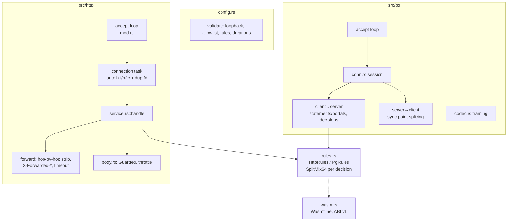

# Architecture

ChaosProxy-L7 is one binary with two independent listeners (HTTP and PostgreSQL) that share only the
decision engine, the global concurrency limiter, and the safety rules in the config.

## Decision model

`rules.rs` is pure apart from per-rule concurrency counters. For each request it builds a SplitMix64 generator
from `(seed, stream id, sequence number)` — stream 1 is HTTP, stream 2 PostgreSQL — and walks the rules in order.
A rule whose matcher holds always consumes one roll, so the outcome for a given sequence number does not depend
on how many earlier rules were skipped by their caps. Jitter is drawn from the same generator, so it is
reproducible too. HTTP sequence numbers are assigned in accept order; PostgreSQL uses
`(connection number << 32) | query number`. Determinism therefore holds for the same seed **and the same request
order** — concurrent clients race for sequence numbers.

## HTTP path

- One `hyper_util::server::conn::auto` connection per TCP stream (HTTP/1.1 or h2c by preface).
- Before hyper takes the socket, the proxy duplicates the file descriptor (`try_clone`). A `reset` fault sends a
  message to the connection task, which sets `SO_LINGER=0` on the duplicate and drops both handles: the last
  close emits RST. `hang` does the same without linger (FIN) after `max`.
- The forwarder rewrites the URI to the allowlisted upstream authority, strips hop-by-hop headers in both
  directions, and applies `request_timeout` to the response head only (bodies stream).
- Response bodies are wrapped in `Guarded`, which keeps the global permit and the rule's cap slot alive until the
  body is finished or dropped. `throttle` moves the upstream body into a task that re-chunks it into 1/20 s
  slices behind a capacity-1 channel, preserving backpressure.
- If the client disconnects, hyper drops the service future, which drops the in-flight upstream request.

## PostgreSQL path

The proxy relays opaque frames but parses enough to make decisions. The key invariant is ordering under
pipelining: every forwarded `Query` and `Sync` is a *sync point* answered by exactly one `ReadyForQuery`
(the startup handshake's `ReadyForQuery` is sync point 1). Injections are tagged with sync-point numbers:

| Fault | Client→server half | Server→client half |
|---|---|---|
| `error` on `Query` | withholds the `Query`, sends `Standalone{after = forwarded sync points}` | writes `ErrorResponse` + `ReadyForQuery(last status)` once all earlier sync points are answered |
| `error` on `Execute` | withholds `Execute` and every message until `Sync`, forwards `Sync`, sends `BeforeRfq{idx}` | writes the `ErrorResponse` immediately before the `ReadyForQuery` for `idx` (after `ParseComplete`/`BindComplete`) |
| `delay` | sleeps, then forwards | — |
| `drop_mid_result` | sends `DropAfter{idx, rows}`, then forwards | after `rows` `DataRow`s of the result ending at `idx`, ends the session (both sockets close) |
| `reject_startup` | answers the `StartupMessage` with `FATAL` before connecting upstream | — |

The server→client half drains pending splice messages before decoding each server frame, so a `DropAfter`
sent before its query was forwarded is always seen first. Its socket reads use `read_buf` into a buffer, which
is cancellation-safe inside `select!` (an earlier draft used `read_exact` there and could lose half a frame).

Statements are tracked by name from `Parse`, portals from `Bind`, so a fault on `Execute` matches the SQL text
of the statement behind the portal.

## WebAssembly

`wasm.rs` compiles each module once (`InstancePre`) and instantiates it per decision in a new `Store` with
fuel, an epoch deadline (a background thread ticks every 5 ms), and `StoreLimits` (growth beyond the limit
traps). Modules may not import anything. See the ABI table in the module docs.

## Trade-offs

- **No TLS**: keeps the tool small and avoids certificate handling; it limits h2 to h2c and PostgreSQL to
  `sslmode=disable/prefer`.
- **One upstream per listener**: simpler allowlisting and reasoning; run several proxies for several upstreams.
- **Faults withhold work**: injected errors are not sent upstream, so they never have side effects — but they
  also do not exercise server-side state (for example, transactions are not aborted).
